# Extracted Document Data: RY-2025-2026
**Source:** 

Mask Distribution Project - 07th July 2025 Sadik Model School

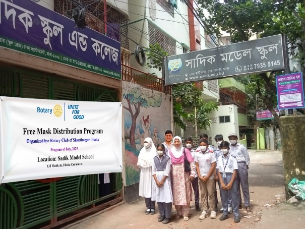
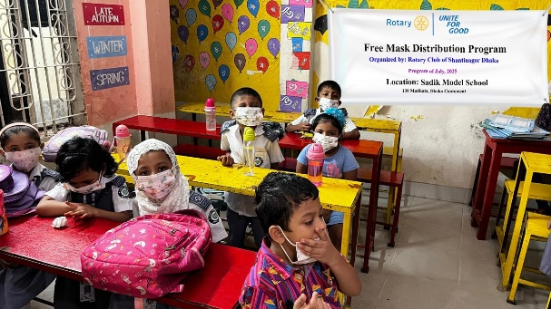

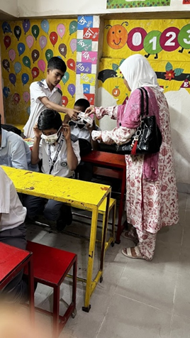

200 pes Mask  Amount -  2,000/-

UNITING FOR GOOD:The Rotary Club of Shantinagar, Dhaka successfully conducted a Free Mask Distribution Program at Sadik Model School, reaffirming its commitment to care, compassion, and community responsibility. Through this initiative, the club emphasized the importance of health awareness while standing beside the community in promoting safety and collective well-being.

Mask Distribution to Schools:This initiative aimed to improve health safety by distributing masks in schools, benefiting approximately 200 people.

Pusti Box  30th August 2025  Azimpour Maternity Hospital

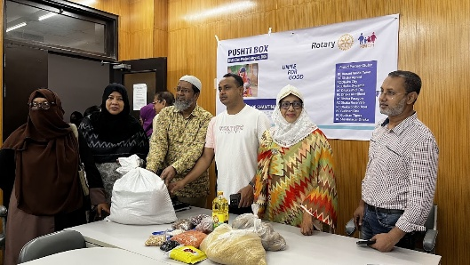
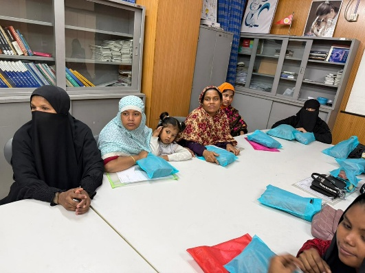

Taka :  (12 X 2700 ) = 32,400/-

As part of the club’s ongoing commitment to community service, the Pusti Box Distribution Program was successfully conducted on 30th August 2025 at Azimpur Maternity Hospital. The initiative aimed to support expectant and new mothers by providing nutritious food items, reflecting the club’s dedication to maternal health, care, and social responsibility.

Project Report: Pusti Box Distribution for Pregnant Mothers

Project Title Pusti Box Distribution Program for 20 Pregnant Mothers

Project Location Azimpur Maternity Hospital

Implementing Organization Shantinagar Club

Project Duration [July’2025 to June’ 2026]

Background Proper nutrition during pregnancy is very important for both mother and baby. Many pregnant women from low-income families do not get enough nutritious food. To support them, this project was designed to provide “Pusti Boxes” containing essential healthy food items.

Objectives To improve nutrition of pregnant mothers

To support healthy pregnancy and safe delivery

To raise awareness about maternal health

To help underprivileged families

Target Beneficiaries Total: 20 pregnant mothers

Nutritional supplements (if applicable)

Basic awareness discussion on nutrition and care

Benefits / Impact Improved nutrition for pregnant mothers

Better health condition for both mother and baby

Increased awareness about healthy food habits

Financial relief for poor families

Community support and engagement

Challenges Limited budget

Identifying the most needy beneficiaries

Time management during distribution

Conclusion The project was successfully completed with the support of Shantinagar Club. It helped 20 pregnant mothers receive necessary nutrition support. Such initiatives should continue to ensure healthy motherhood and child development.

World Polio Day   24th October 2025   (End Polio Day 2025)

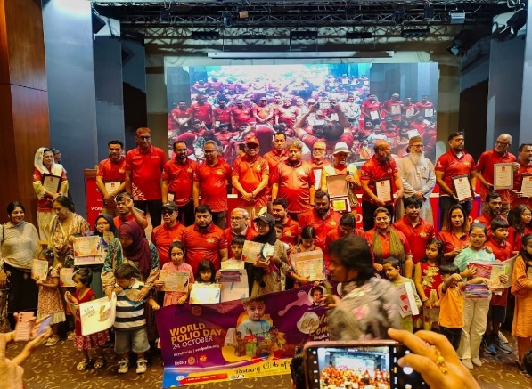
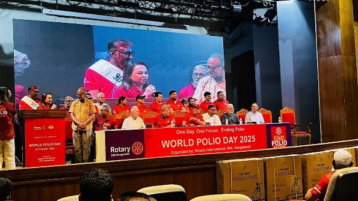
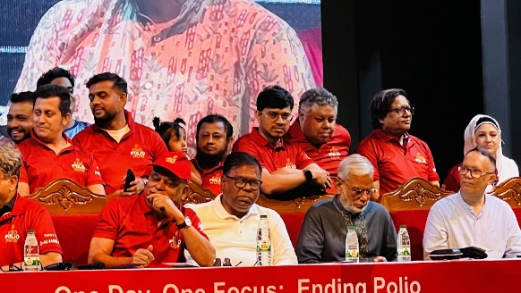

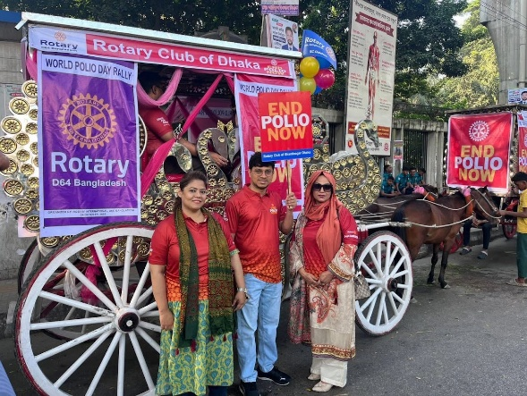

Amount – 6,000/-  6 person

End Polio Day, observed on 24 October 2025, is a global initiative led by Rotary International to raise awareness and reaffirm commitment to the complete eradication of polio from the world.

Over the past decades, Rotary and its partners have played a vital role in reducing polio cases by more than 99 percent worldwide. Despite this remarkable progress, the fight is not over. End Polio Day reminds us that continued vigilance, vaccination, and collective action are essential to protect future generations.

On this occasion, our club proudly stands with Rotary’s global mission to create a polio-free world. Through awareness programs, advocacy, and support for immunization efforts, we reaffirm our dedication to safeguarding children’s health and ensuring a healthier tomorrow.

Benefits / Impact : Together, we can end polio—once and for all.

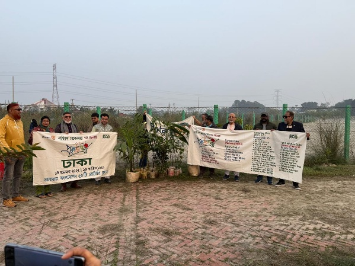
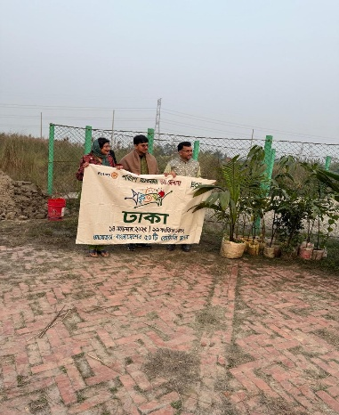

Tree Plantation Program by Rotary Clubs

A tree plantation program was successfully organized with the active participation of Rotary members and partner clubs. The program was held in an open area of Dhaka as part of Rotary’s ongoing commitment to environmental protection and sustainability.

During the event, Rotary members gathered together holding banners and saplings to demonstrate their collective effort toward creating a greener and healthier environment. Various types of tree saplings were planted, emphasizing the importance of increasing green coverage and raising awareness about climate change and environmental responsibility.

The program was conducted under the theme of protecting nature and promoting eco-friendly initiatives. Members enthusiastically took part in the plantation activities, reflecting Rotary’s strong dedication to community service and environmental conservation.

This initiative highlights Rotary’s continued efforts to contribute positively to society by working for a sustainable future and encouraging people to take part in protecting the environment.

Benefits / Impact :

Zonal Learning Assembly 2025,  06th December 2025  -  BIAM Auditorium

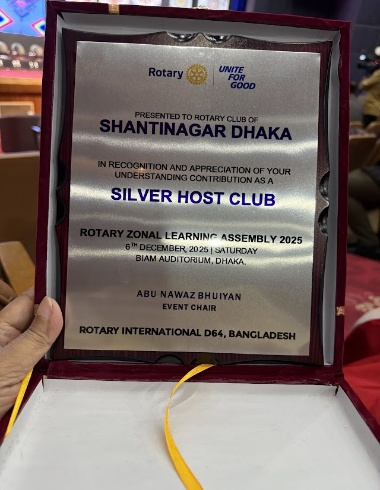
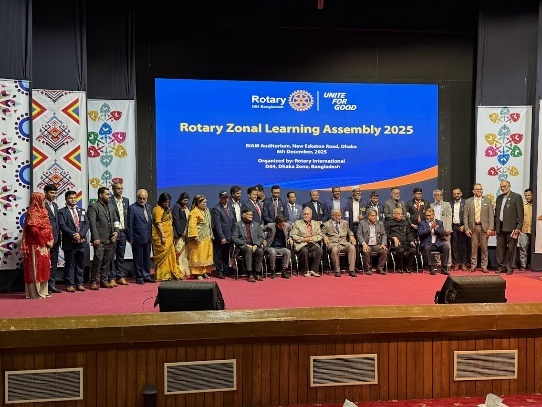

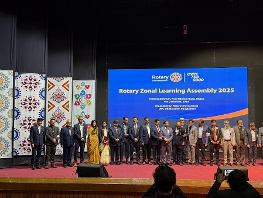

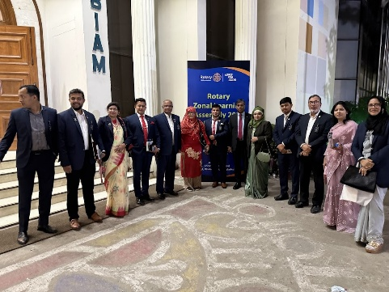
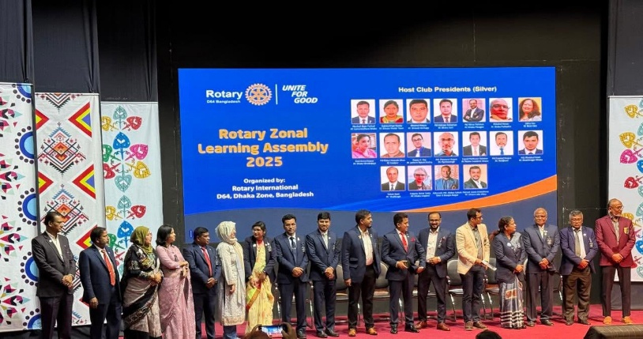

Amount – 25,000/-

Zonal Learning Assembly 2025 Date: 06 December 2025

The Zonal Learning Assembly 2025 was held successfully on 06 December 2025, bringing together Rotarians from various clubs of the zone for a day dedicated to learning, leadership development, and fellowship. The assembly aimed to strengthen Rotary knowledge, enhance leadership capacity, and encourage collaboration among clubs.

The event was graced by distinguished Rotary leaders who shared their experiences, guidance, and vision for effective club functioning and impactful service projects. Interactive sessions and presentations enriched the participants with practical insights and renewed motivation to serve with excellence.

The assembly concluded on a high note, reinforcing unity among Rotarians and preparing leaders to carry forward Rotary’s mission with confidence and commitment.

📌 Pitha Utsob Highlights 10th January 2026

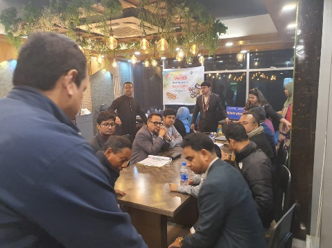
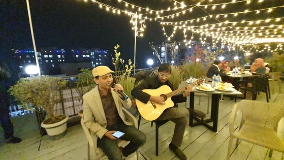
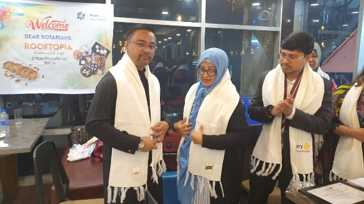

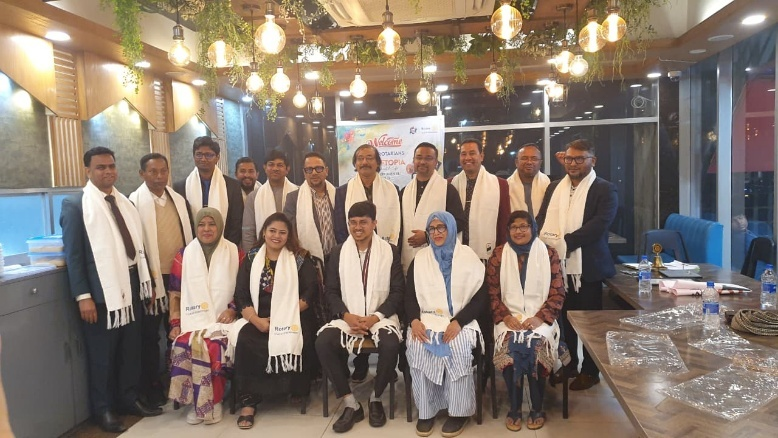

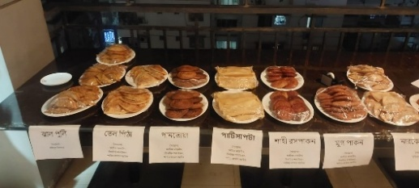

📌 Pitha Utsob Highlights 10th January 2026

The Rotary Club of Off Shantinagar, Dhaka successfully organized a joyful Pitha Utsob, celebrating the rich tradition of Bangladeshi winter delicacies.

The venue was beautifully decorated, and a wide variety of traditional pithas were displayed and served, creating a warm and festive atmosphere. Members and their families actively participated and enjoyed different kinds of homemade pithas, making the event lively and memorable.

The program reflected fellowship, cultural heritage, and togetherness among Rotary members. We sincerely thank all the members and volunteers for their support and contribution in making this event a great success. Together, we continue to celebrate tradition, friendship, and service.

Total Amount : 42,000/- in the RoofTopia, Dhanmondi R/A

Winter Clothes Distribution Program 2026 Shantinagar Club

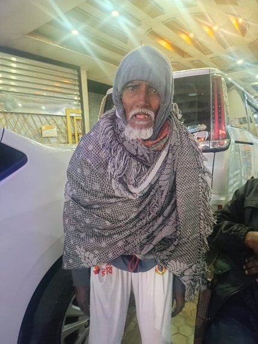
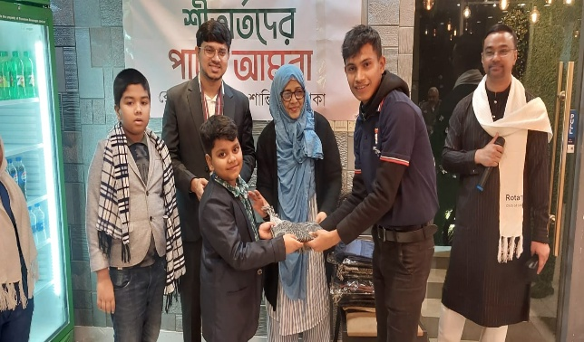

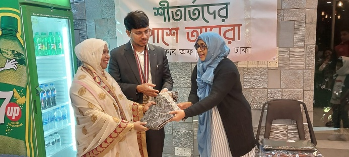
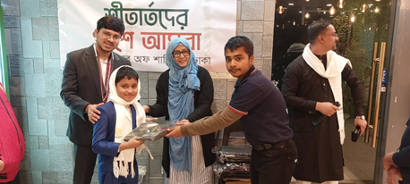

Winter Clothes Distribution Program 2026 Shantinagar Club

In the winter of 2026, Shantinagar Club organized a Winter Clothes Distribution Program with the aim of bringing warmth, dignity, and compassion to underprivileged members of the community. As temperatures dropped, the club stepped forward to support those most vulnerable to the harsh cold, especially elderly individuals, children, and daily wage earners.

Members of Shantinagar Club personally distributed warm clothes, sharing not only essential winter wear but also kindness and care. The heartfelt smiles and gratitude of the recipients reflected the true spirit of service. Through this initiative, the club reaffirmed its commitment to standing beside humanity in times of need and strengthening the bond between the community and service-oriented leadership.

This meaningful program once again highlighted Shantinagar Club’s dedication to social responsibility and its belief that small acts of kindness can make a lasting difference.

Total Amount : 32,000/-  100 pes Shal verities area distribution,

GRAND CLOSING Prokiti Jatra  09th January 2026,   Amount : 5,000/-

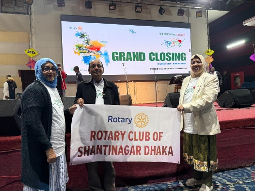

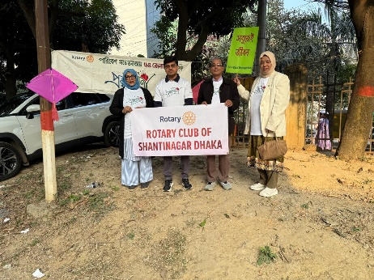
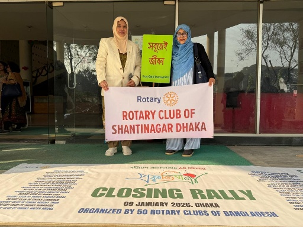

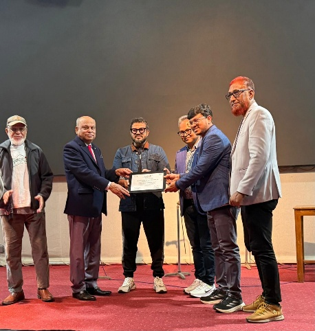
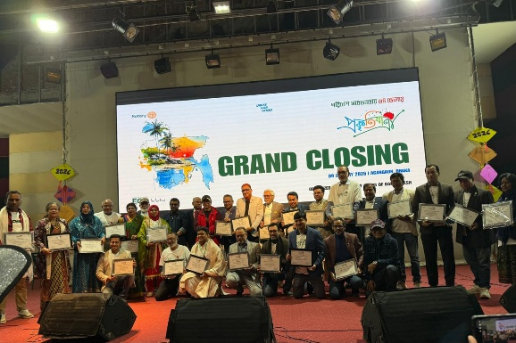

Members of the Rotary Club of Shantinagar Dhaka proudly participated in the Closing Rally on 9 January 2026, organized by 50 Rotary Clubs of Bangladesh. Holding the club banner, Rotarians demonstrated unity and commitment to Rotary’s values of service, peace, and community engagement. The rally marked a successful conclusion to the collective initiative, reflecting strong collaboration among clubs and reinforcing Rotary’s shared mission of positive social impact.

Total Amount : 25,000/-

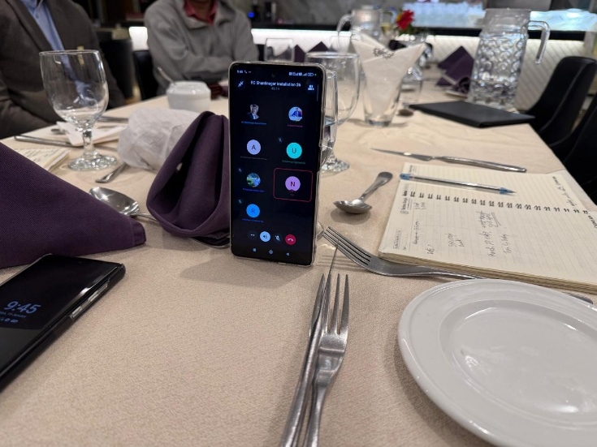
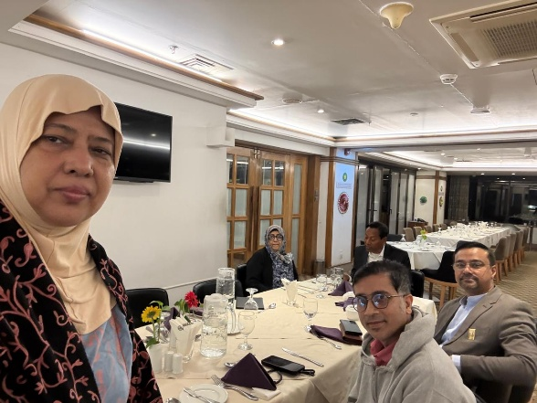

OCB & Installation meeting 19/01-/-2026 BRAC Center Mohakhali

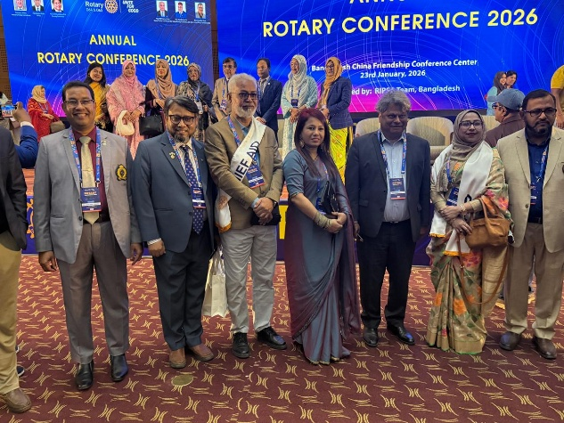
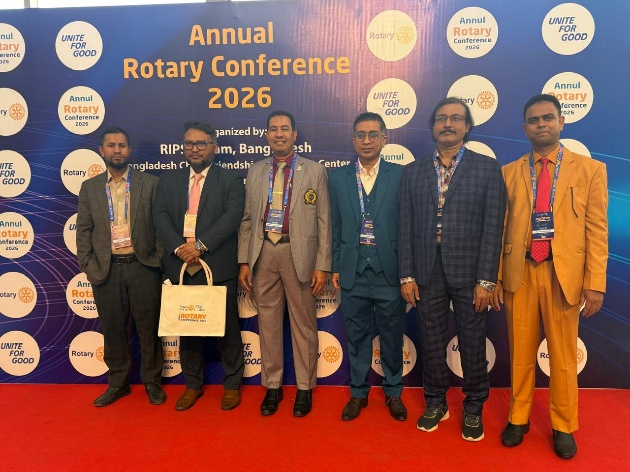

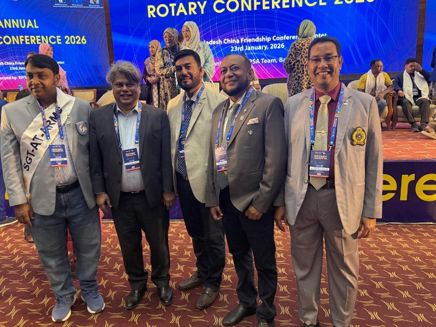
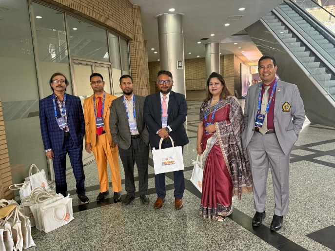

Rotary Conference 2026,   Rotary International D64 & D65, Bangladesh

Date 23/01/2026   Amount:  10,0000  Bronze Host

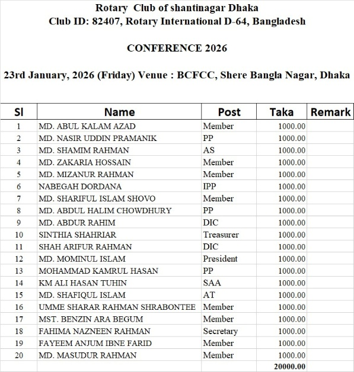

For sponsorship for Bronze Host: (BDT 10,000), following payments have been collected :

1. Nabegah Dordana - Tk.2,000.

2. Shah Arifur Rahman - Tk.2,000

3. Fayeem Bhai - Tk.2,000

4.  Shamim Abir - Tk.2,000

5. ⁠Shintia Shariar - Tk.2,000

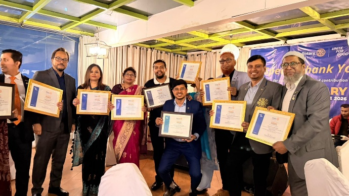
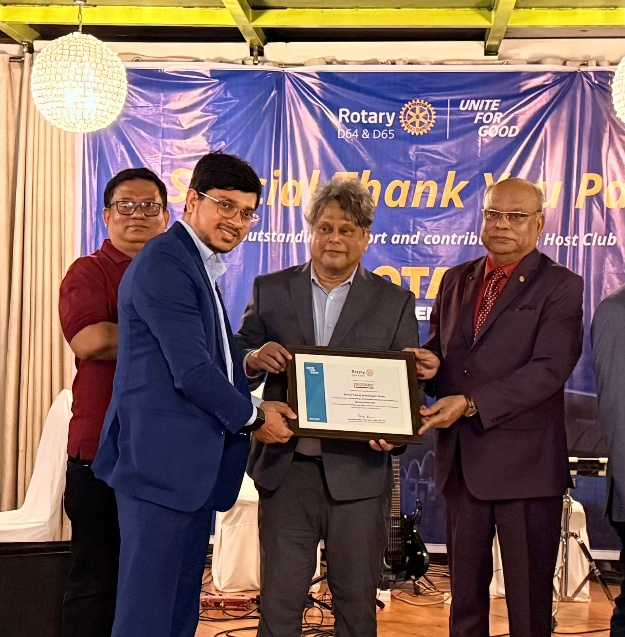

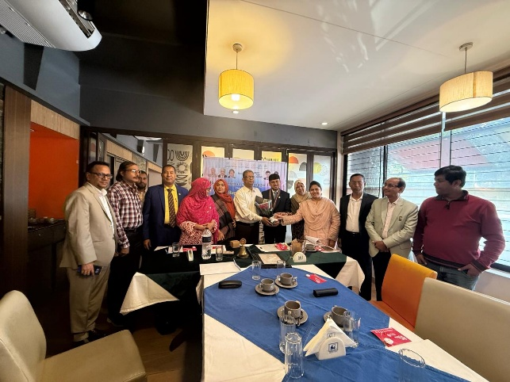

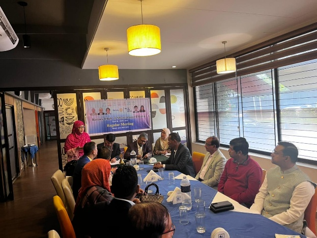

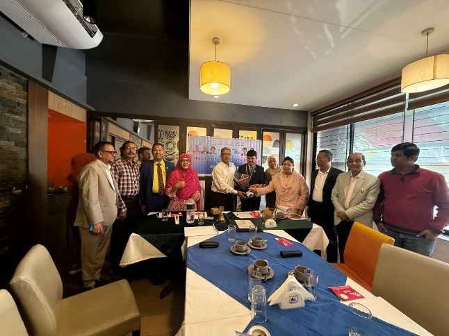

Date: 28/01/2026 Breakfast Meeting in Dhaka Club

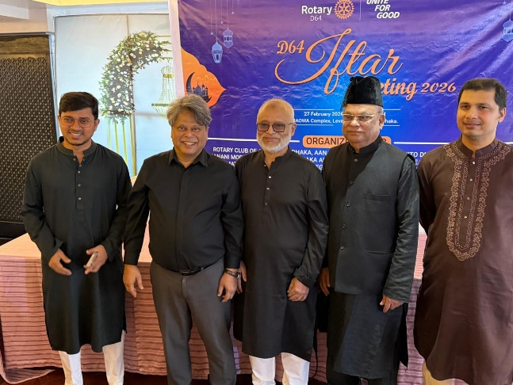

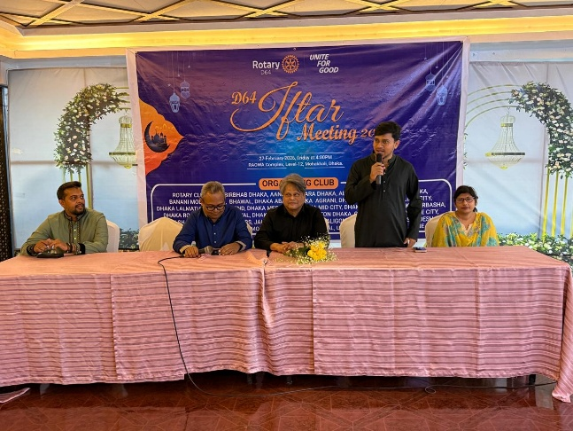

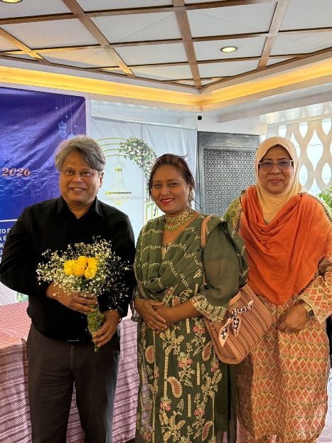
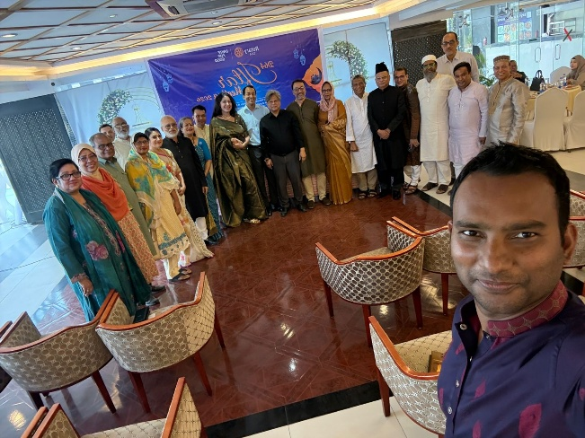

Meeting and Iftar Raowa Convention Hall Date: 27/02/2026

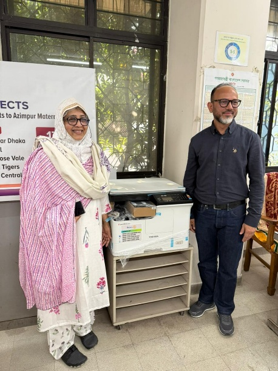
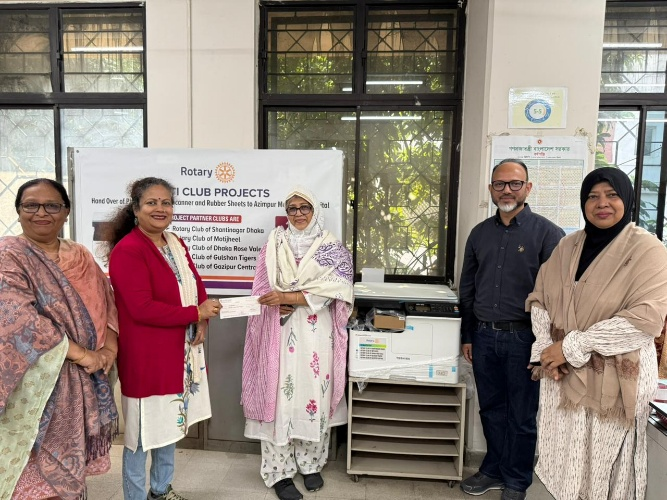

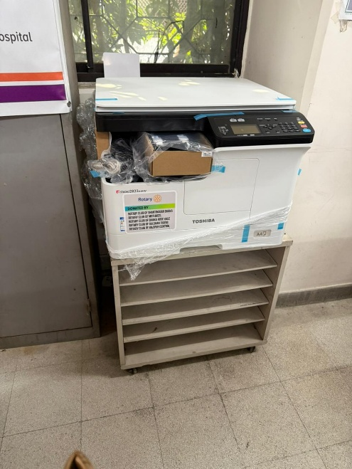

Azimpour Maternity Hospital Date:         Amount 75,000/- taka

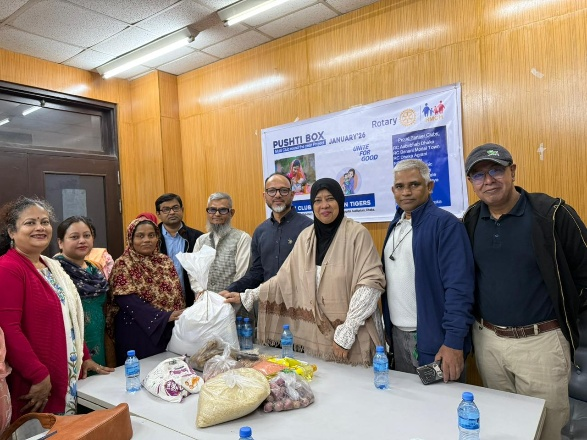

Azimpour Maternity Hospital Pusti Box

Rotary Public Image Roadshow

River Crue Sundorbon

ইদারার মূলকেন্দ্র মাদ্রাসা, মানিকা -৮৩২০, বোরহানউদ্দিন, ভোলা। Taka : 6,000/- Iftary

Azimpour Maternity Hospital  Date:                                  Amount 95,000/-

Polio USD Fund contribution Rotary International

| Month of July 2025 | 1st Meeting |
| --- | --- |
| Category | Bill | Amount | Date paid | Done |
| 1st Meeting in the Banani Club | Hall Expense | 3,000.00 |  |  |
|  | Food Expanse | 9,215.00 |  |  |
|  | Crest for 5nos PP & IPP | 10,200.00 |  |  |
|  | Gift for Assistant Coordinator | 1,290.00 |  |  |
|  | Gift for PP (Rist  Wachet ) | 5,644.00 |  |  |
|  | Flower for PP | 1,200.00 |  |  |
|  | Sweet for meeting | 400.00 |  |  |
|  | Conveyance | 1,385.00 |  |  |
|  | Banar | 500.00 |  |  |
|  | Total : | 32,834.00 |  |  |

Month of July 2025

1st Meeting

Category

Bill

Amount

Date paid

Done

1st Meeting in the Banani Club

Hall Expense

3,000.00

Food Expanse

9,215.00

Crest for 5nos PP & IPP

10,200.00

Gift for Assistant Coordinator

1,290.00

Gift for PP (Rist Wachet)

5,644.00

Flower for PP

1,200.00

Sweet for meeting

400.00

Conveyance

1,385.00

Banar

500.00

Total :

32,834.00

| Month of August 2025 | 2nd Meeting |
| --- | --- |
| Category | Bill | Amount | Date paid | Done |
| General Meeting in the Sky City | Food Expanse | 8,279.00 | 30/08/25 |  |
|  | Banar | 500.00 |  |  |
|  | Total : | 8,779.00 |  |  |

Month of August 2025

2nd Meeting

Category

Bill

Amount

Date paid

Done

General Meeting in the Sky City

Food Expanse

8,279.00

30/08/25

Banar

500.00

Total :

8,779.00

