# Extracted Document Data: RY-2026-2027
**Source:** 

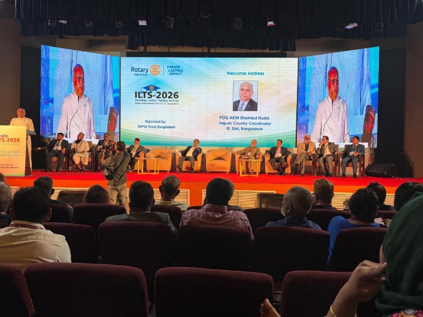
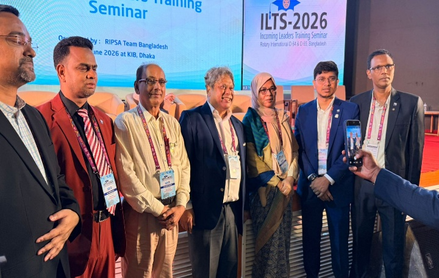
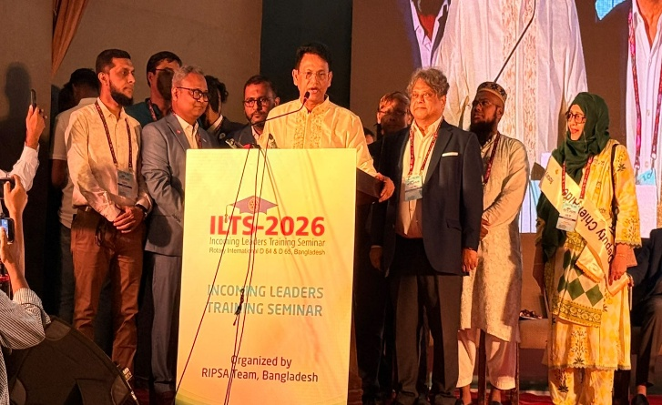
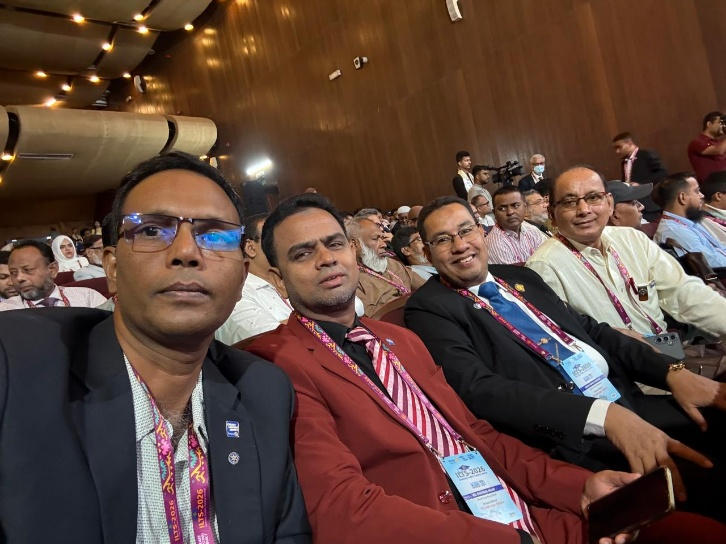

Rotary Club of Shantinagar, Dhaka at ILTS 2026

The Rotary Club of Shantinagar, Dhaka proudly participated in the Incoming Leaders Training Seminar (ILTS) 2026, a prestigious leadership development program organized by RIPSA Team Bangladesh. The seminar brought together Rotary leaders, incoming club officers, and distinguished guests from across the country to strengthen leadership, fellowship, and service excellence.

The event featured inspiring keynote addresses from senior Rotary leaders, interactive training sessions, and opportunities for networking among Rotarians committed to creating lasting community impact. Representatives of the Rotary Club of Shantinagar actively engaged in the sessions, exchanging ideas and learning best practices for effective club leadership.

The group photograph highlights the enthusiastic participation of the club's delegates, reflecting their commitment to Rotary's core values of Service Above Self, ethical leadership, and sustainable community development.

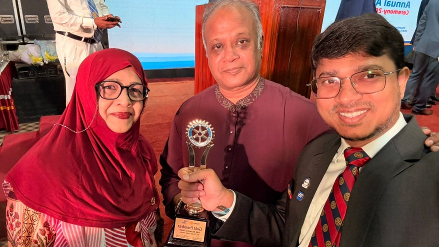
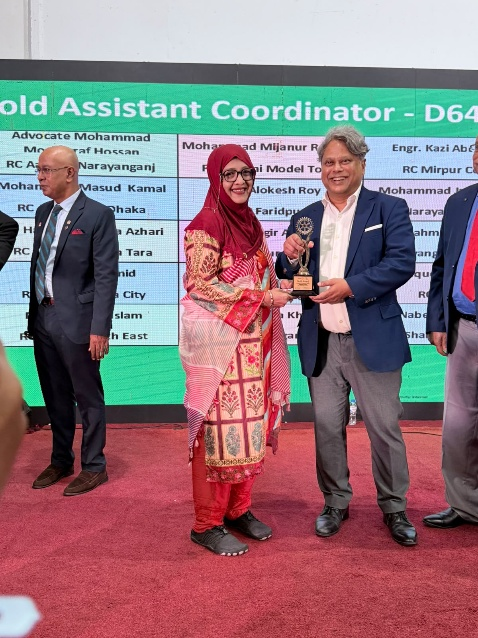
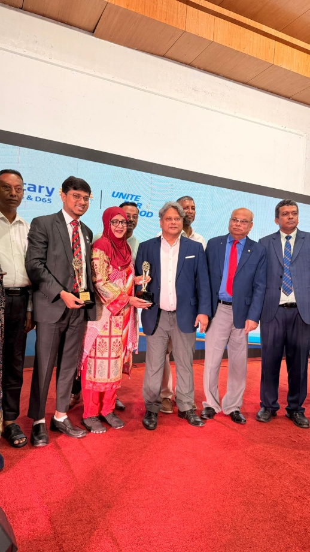
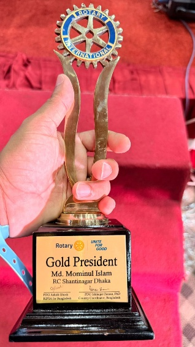
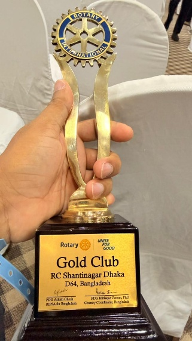

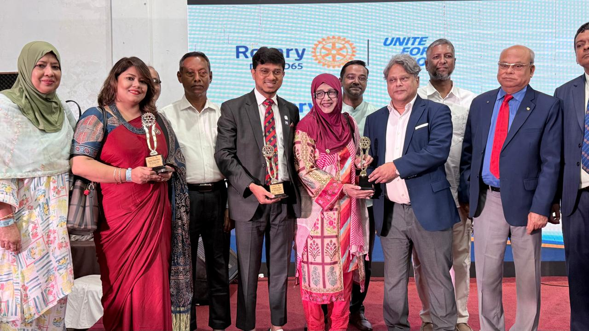

Rotary Annual Award Ceremony 2026

The Rotary Club of Shantinagar, Dhaka proudly participated in the Rotary Annual Award Ceremony 2026, celebrating the dedication and achievements of Rotarians who have made outstanding contributions to humanitarian service and community development.

During the ceremony, representatives of the Rotary Club of Shantinagar were recognized with prestigious awards for their exemplary leadership, commitment, and unwavering service to Rotary's mission. These honors reflect the club's continuous efforts to implement impactful projects in the areas of education, health, youth empowerment, environmental sustainability, and community welfare.

The award recipients stand as a source of inspiration, demonstrating that teamwork, integrity, and a passion for service can create meaningful and lasting change. Their achievements reinforce the club's commitment to Rotary's core values of fellowship, diversity, integrity, leadership, and "Service Above Self."

The Rotary Club of Shantinagar, Dhaka extends its heartfelt congratulations to all award recipients and remains dedicated to expanding its service initiatives, empowering communities, and making a positive impact through Rotary's global network.

Together, we unite for good, celebrate excellence, and continue building a better future through service.

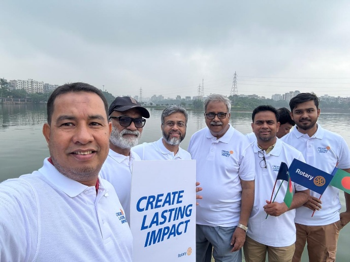
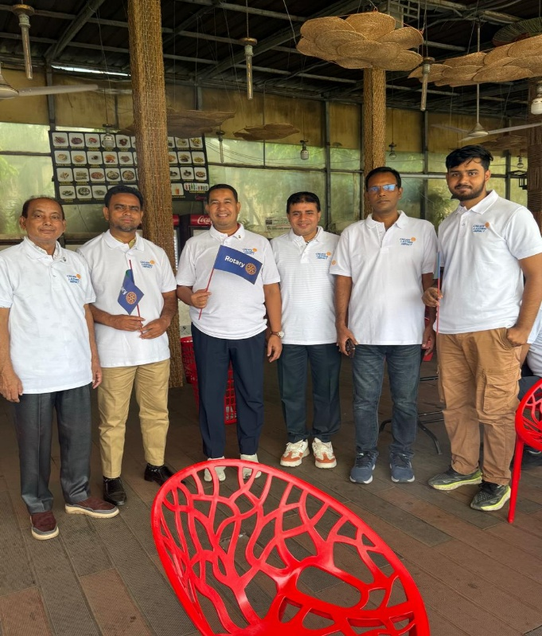
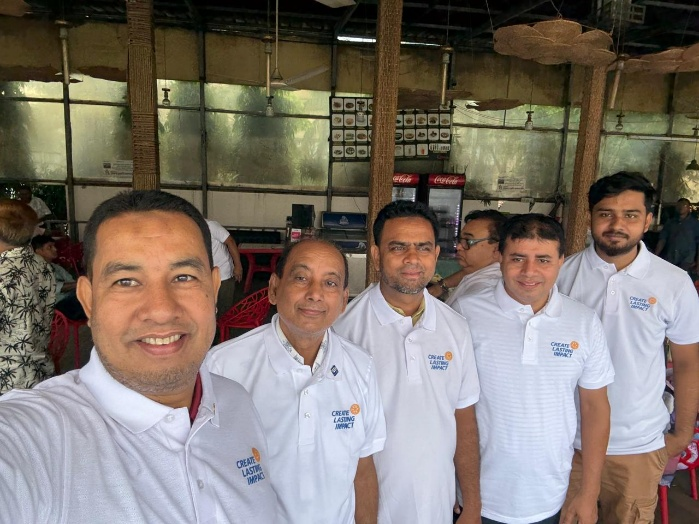

Year Launching Rally 2026 – Rotary Club of Shantinagar, Dhaka

The Rotary Club of Shantinagar, Dhaka proudly participated in the Year Launching Rally 2026 (RID 64, Bangladesh), held at Hatirjheel, Modhubag Point, Dhaka, under the Rotary International theme "Create Lasting Impact."

The rally marked the beginning of the new Rotary year, bringing together Rotarians from numerous clubs across the district to renew their commitment to service, leadership, and community engagement. As one of the host clubs, the Rotary Club of Shantinagar actively supported the event and joined fellow Rotarians in promoting Rotary's vision of creating sustainable and meaningful change.

A key highlight of the rally was the End Polio Now campaign, reaffirming Rotary's unwavering commitment to eradicating polio worldwide. Through awareness activities and collective participation, members demonstrated their dedication to one of Rotary's most significant global humanitarian initiatives.

The event also strengthened fellowship among Rotarians, inspired collaboration, and encouraged members to embark on a new Rotary year with renewed enthusiasm and purpose. The Rotary Club of Shantinagar, Dhaka remains committed to implementing impactful service projects that improve lives, empower communities, and uphold Rotary's motto, "Service Above Self."

Together, we create lasting impact—one project, one community, and one life at a time. 💙🌍🕊️

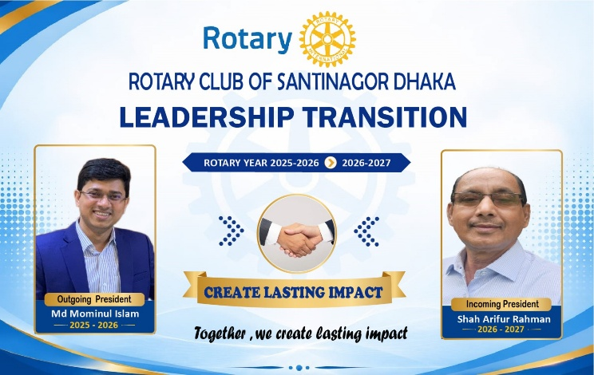
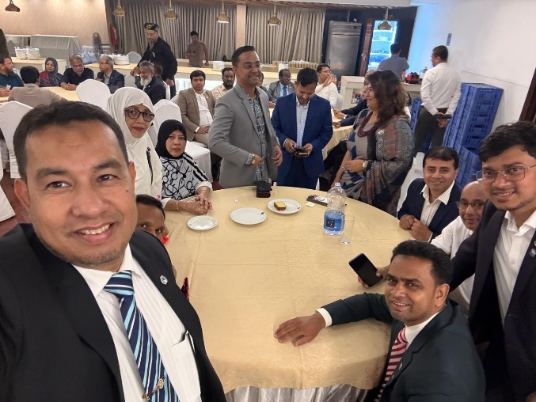

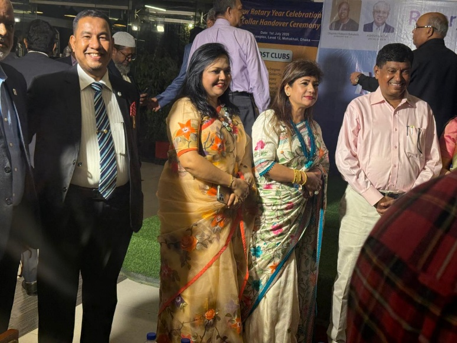
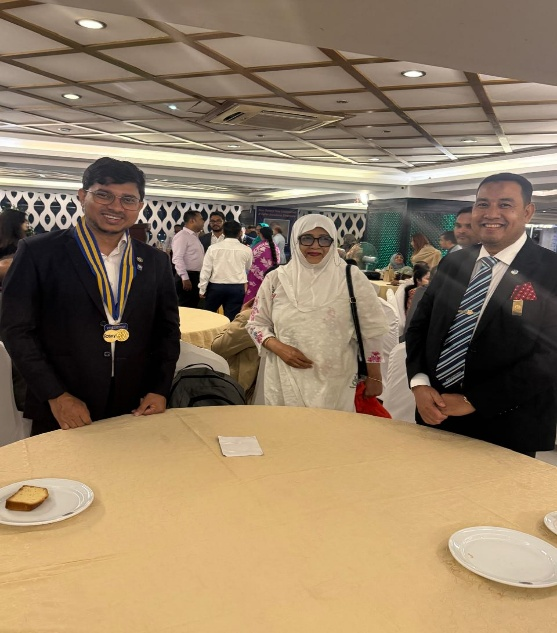
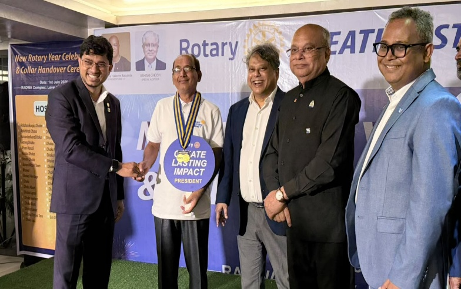

Leadership Transition 2026–2027

Rotary Club of Shantinagar, Dhaka

The Rotary Club of Shantinagar, Dhaka proudly marked its Leadership Transition for the Rotary Year 2026–2027. The club sincerely thanks Outgoing President Md. Monirul Islam for his dedicated service and warmly welcomes Incoming President Shah Arifur Rahman to lead the club with the vision of "Create Lasting Impact."

Together, we remain committed to Service Above Self and to making a lasting difference in our community.

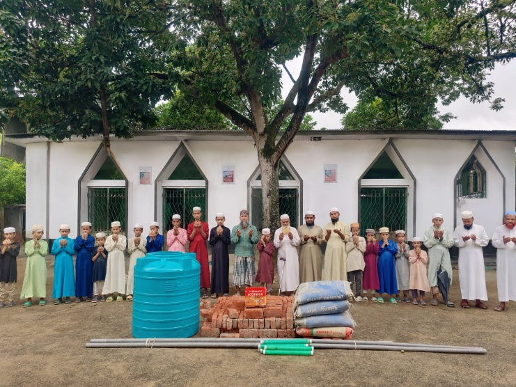

Sanitation and water support to Cox's Bazar Madrassahs:

1. Nabegah Dordana - 10,000 Tk.

2. Mr. Abdullah - 3,000 Tk.

3. Md Mominul Islam - 5000/-

4. Fayeem Bhai - 20,000 Tk.

5. Shamim Bhai - 12,000 Tk

Alhamdulillah Tk.50,000 hoye gechhe, pray.

Alhamdulillah! The Project Has Been Successfully Completed. 🤲

With the grace of Allah and your generous support, we are delighted to share that the Wudu (Ablution) Facility Project for a madrasa in Cox's Bazar has been successfully completed.

This initiative was undertaken to provide students, teachers, and worshippers with a clean and convenient place to perform wudu before their prayers. Thanks to your kindness and heartfelt contributions, we were able to deliver the necessary construction materials and complete this meaningful project.

This is more than just a construction project—it is a Sadaqah Jariyah (continuous charity). Insha'Allah, every person who performs wudu and offers salah using this facility will be a source of ongoing reward for everyone who contributed to making it possible.

We sincerely thank each and every donor, supporter, and well-wisher who stood by us throughout this journey. Your generosity has made a lasting impact on this madrasa and its community.

May Allah (SWT) accept your charity, bless you with abundant rewards, and make this project a means of continuous blessings in this life and the Hereafter. Ameen.

Jazakum Allahu Khairan to everyone who made this project a success. 💚

